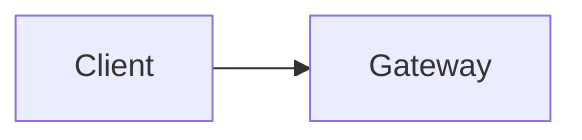

# Zensical cheat sheet

Zensical (https://zensical.org, `pip install zensical`) builds a static documentation site from Markdown
in `docs/` and one config file, `zensical.toml`. It is the successor of Material for MkDocs: same page
syntax, TOML config instead of `mkdocs.yml`. Checked against zensical 0.1.1.

## Commands

| Command | What it does |
|---|---|
| `zensical new [dir]` | starter project: `zensical.toml`, `docs/index.md`, `docs/markdown.md`, `.github/workflows/docs.yml` |
| `zensical serve` | preview with live reload on http://localhost:8000 |
| `zensical build --clean` | static site in `site/` (add `site/` to `.gitignore`) |

## zensical.toml

Everything sits under `[project]`; theme settings under `[project.theme]`.

```toml
[project]
site_name = "my-project"                      # required
site_description = "One sentence."
site_url = "https://org.github.io/my-project/"
repo_url = "https://github.com/org/my-project"
repo_name = "org/my-project"
edit_uri = "edit/main/docs/"                  # "edit this page" links
copyright = "MIT licensed."

nav = [                                       # paths relative to docs/
  { "Home" = "index.md" },                    # a single page: { "Title" = "file.md" }
  { "Guide" = [                               # a section: { "Title" = [ files ] }
    "guide/index.md",                         # bare path: title from the page's "# Heading"
    "guide/install.md",
  ] },
]

[project.theme]
language = "en"
features = ["navigation.sections", "navigation.indexes", "navigation.footer",
            "content.code.copy", "content.tabs.link", "search.highlight", "toc.follow"]

[[project.theme.palette]]                     # one block per colour scheme
media = "(prefers-color-scheme: light)"
scheme = "default"
[[project.theme.palette]]
media = "(prefers-color-scheme: dark)"
scheme = "slate"
```

- `nav` must be a key of `[project]`, before the first `[project.*]` table header (TOML puts every key
  below a header into that table). Without `nav`, all pages appear, in folder order.
- `navigation.indexes`: a section's `index.md` becomes the section's own page.
- Without a `[project.markdown_extensions]` table, admonitions, tabs, details, footnotes, tables and
  Mermaid already work. Listing extensions there replaces the defaults, so list all you need.

## Page syntax

~~~~markdown
# Page title                    <- one H1 per page, used as the nav title

Link other pages by relative file path: [Install](../guide/install.md), [anchor](install.md#docker)

!!! note "Optional title"       <- also tip, info, warning, danger, example, question
    Indented four spaces.

??? warning "Collapsed"         <- ???+ for open by default
    Hidden until clicked.

=== "Linux"
    ```bash
    ./setup.sh
    ```
=== "macOS"
    ```bash
    brew install foo
    ```



| Option | Default |
|---|---|
| `PORT` | `8080` |

Term
:   Definition list entry.

Text with a footnote.[^1]

[^1]: The footnote.

++ctrl+c++ for keys, `#!python print()` for highlighted inline code.
~~~~

Code blocks take a language (` ```bash `, ` ```toml `, ` ```yaml `) and options like
` ```python title="app.py" linenums="1" hl_lines="2 3" `.

## Publishing on GitHub Pages

Repository *Settings → Pages → Source: GitHub Actions*, then a workflow like the one `zensical new` writes:

```yaml
on: { push: { branches: [main] } }
permissions: { contents: read, pages: write, id-token: write }
jobs:
  deploy:
    environment: { name: github-pages, url: "${{ steps.deployment.outputs.page_url }}" }
    runs-on: ubuntu-latest
    steps:
      - uses: actions/configure-pages@v6
      - uses: actions/checkout@v7
      - uses: actions/setup-python@v6
        with: { python-version: 3.x }
      - run: pip install zensical      # pin it, e.g. zensical==0.1.1, so a release can't break the build
      - run: zensical build --clean
      - uses: actions/upload-pages-artifact@v5
        with: { path: site }
      - uses: actions/deploy-pages@v5
        id: deployment
```

The site is then at `https://<owner>.github.io/<repo>/`; set that as `site_url`.

## With IMGAgent

`@IMGAgent make docs` writes `docs/` and the `nav`, and creates a complete `zensical.toml` when there is
none; an existing file keeps everything except `nav`. `@IMGAgent update docs <task>` makes small edits to existing pages.
Neither adds the Pages workflow (the App has no permission to change workflows): add it by hand once.
