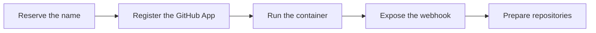

# Setup overview

Setting up IMGAgent takes five steps: reserve the name, register a GitHub App, run the container, make it reachable from GitHub, and prepare your repositories. This page lists what you need first and the order to follow.

## What you need beforehand

| You need | Why |
|---|---|
| A GitHub account that can create an organisation | The `@IMGAgent` name must belong to an account you own. The App is registered under that organisation. |
| A server with Docker and Docker Compose | IMGAgent runs as one container. [Dockge](https://github.com/louislam/dockge) is supported but optional; plain `docker compose` works too. |
| A reverse proxy or tunnel on that server | GitHub sends webhooks over HTTPS. The container only publishes its port on `127.0.0.1`. |
| A domain name that reaches the server over HTTPS | The webhook URL has the form `https://<your-domain>/webhook`. |
| An Anthropic API key | Claude does the work for `signoff` and the `docs` commands. Use a Claude Console key, ideally in a workspace with a spend limit. |

## The steps

1. [Reserve the @IMGAgent name](reserve-name.md). Create an empty organisation called `IMGAgent`, so that `@IMGAgent` in a comment links to an account you control.
2. [Register the GitHub App](github-app.md). Set its permissions and events, choose the webhook URL and secret, generate the private key, and install the App on the repositories it should work in.
3. [Run the container](deploy.md). Clone the repository, fill in `.env`, place the private key as `imgagent.pem`, and start the stack. The log should say `signed in as the GitHub App`.
4. [Expose the webhook to GitHub](expose.md). Put a reverse proxy or tunnel in front of `127.0.0.1:8080`, then test with a redelivered `ping` and an `@IMGAgent help` comment.
5. [Prepare a repository](per-repository.md). Most commands need nothing; `ask` and `update` need the folders you name and `signoff` needs a `SIGNOFF.toml`.

!!! note
    The webhook URL and secret are entered in the App's settings in step 2, before the server exists. Use the URL you plan to serve in step 4. The same secret goes into `.env` as `IMGAGENT_WEBHOOK_SECRET` in step 3.

## Values you will collect

Along the way you produce a few values that the container reads from `.env` and the key file. The [configuration reference](../reference/index.md) lists every setting.

| Value | Comes from |
|---|---|
| `IMGAGENT_APP_ID` | Shown at the top of the App's settings page |
| `IMGAGENT_WEBHOOK_SECRET` | A long random string you choose, for example from `openssl rand -hex 32` |
| `imgagent.pem` | The private key you generate for the App |
| `IMGAGENT_ALLOWED_OWNERS` | The accounts whose installations may be answered, such as `industrial-mathematics-group` |
| `ANTHROPIC_API_KEY` | Your Claude Console workspace |

After the setup works, see [Operating IMGAgent](../operations/index.md) and [Troubleshooting](../operations/troubleshooting.md).
