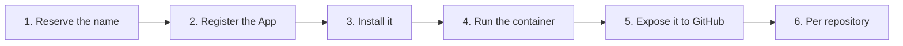

# Getting started

Setting up IMGAgent takes six steps: reserve the name, register the GitHub App, install it, run the container, expose it to GitHub, and prepare each repository. Do them in this order. Some values from one step are needed in the next, such as the webhook URL, the App ID and the private key.

## What you need

- **A server with Docker.** IMGAgent runs as one container, built locally from this repository. The README uses a VPS with Dockge, but `docker compose` on its own works too.
- **A domain with HTTPS.** GitHub sends its webhooks to `https://<your-domain>/webhook`. The container listens on `127.0.0.1:8080`, so you need a reverse proxy or a tunnel in front of it.
- **A Claude Console API key** (`ANTHROPIC_API_KEY`). Put it in a workspace with a spend limit if you can.
- **A GitHub account that can create an organisation and install Apps** on the account whose repositories IMGAgent should serve, for example `industrial-mathematics-group`.

## The steps

1. **[Reserve the name](reserve-name.md).** Create an empty organisation called `IMGAgent`. This makes `@IMGAgent` in a comment point at an account you own, and it lets the App use that name.
2. **[Register the GitHub App](github-app.md).** Create the App under the `IMGAgent` organisation, with:
    - the webhook URL and a webhook secret,
    - the Contents, Issues and Pull requests permissions,
    - subscriptions to the Issues and Issue comment events.

    Note the **App ID** and download a **private key**.
3. **[Install it](github-app.md).** Install the App on your organisation and choose the repositories it should work in. The bot only works in those repositories. You can add more later under the organisation's *Settings → GitHub Apps*.
4. **[Run the container](deploy.md).** Clone this repository on the server, for example into `/opt/stacks/imgagent`. Then:
    - copy `.env.example` to `.env` and fill it in,
    - save the private key as `imgagent.pem`,
    - start the stack.

    The log should say `signed in as the GitHub App imgagent`.
5. **[Expose it to GitHub](expose.md).** Put a reverse proxy (Caddy, Nginx Proxy Manager, Traefik) or a Cloudflare Tunnel in front of `127.0.0.1:8080`. To test it, redeliver the App's `ping` and expect `200 pong`. Then write `@IMGAgent help` in an issue.
6. **[Per-repository setup](per-repository.md).** `ask` and `update` need nothing in the repository. `make docs` writes `docs/` and `zensical.toml`. `signoff` needs a `SIGNOFF.toml`. An optional `.github/imgagent.toml` gives Claude more context. If a repository used the older GitHub Actions bots, delete their workflow files so that two bots don't answer the same command.

## The settings you fill in

Step 4 needs these values in `.env`:

| Variable | From |
|---|---|
| `IMGAGENT_APP_ID` | the App's settings page (step 2) |
| `IMGAGENT_WEBHOOK_SECRET` | the secret you entered when registering the App (step 2) |
| `IMGAGENT_ALLOWED_OWNERS` | the accounts IMGAgent should answer, e.g. `industrial-mathematics-group` |
| `ANTHROPIC_API_KEY` | your Claude Console key |

The private key goes next to `compose.yaml` as the file `imgagent.pem`. The other settings are optional. All of them are listed in [Environment variables](../reference/index.md).

!!! note
    The App can be installed by any account, but the server only answers installations on the accounts in `IMGAGENT_ALLOWED_OWNERS`. Within those accounts, it only answers people with write, maintain or admin permission on the repository. It never answers bots.

Once the setup is done, see [Commands](../usage/index.md) for how to use IMGAgent.
