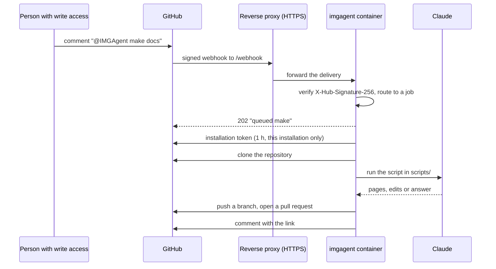

# IMGAgent

IMGAgent is the GitHub bot of the Industrial Mathematics Group, packaged as one small container. People write a command in an issue or a comment. GitHub sends the event to this server, and IMGAgent answers as `imgagent[bot]`.

## What it does

IMGAgent is a GitHub App webhook server. It receives `issues` and `issue_comment` events and verifies their signatures. It gets short-lived installation tokens, clones the repository, and runs the Claude scripts in `scripts/`. It then answers with a comment or opens a pull request.

| Command | Where | What happens |
|---|---|---|
| `@IMGAgent signoff` and your words | new issue or issue comment | Claude turns your words into the answers of the signoff form. IMGAgent opens a `SIGNOFF.toml` pull request, or asks what is missing. |
| `@IMGAgent ask <folders> [with <folders>]` and a question | anywhere in a comment or a new issue | Claude answers from the files in those folders, e.g. `ask docs` or `ask docs,src`. |
| `@IMGAgent update <folders> [with <folders>]` and a task | anywhere in a comment or a new issue | Claude carries out a small task by editing existing files in the folders and at the top level, and reads the `with` folders. IMGAgent opens a pull request. |
| `@IMGAgent make docs [with <folders>]` and a hint | anywhere in a comment or a new issue | Claude rebuilds `docs/` from the code, or only from the `with` folders. IMGAgent opens a pull request. |
| `@IMGAgent help` | anywhere in a comment or a new issue | IMGAgent replies with the list of commands. |
| the issue form *Signoff: declare or attest files* | new or edited issue | IMGAgent opens the `SIGNOFF.toml` pull request without AI. This is controlled by `IMGAGENT_SIGNOFF_FORM`. |

A command starts with an action, then the folders, then the text:

```
@IMGAgent update docs with src
the docs still describe the old commands; bring them in line with the code
```

See [Commands](usage/index.md) for the full syntax. Each command also has its own page: [ask](usage/ask.md), [update](usage/update.md), [make docs](usage/make-docs.md) and [signoff](usage/signoff.md).

## How a command becomes a pull request



The server answers GitHub immediately and runs the job in the background on a small worker pool. The Claude work is done by the scripts in `scripts/`. The server in `imgagent/` only receives events, gets tokens, clones repositories and talks to GitHub.

## Every change is reviewed

- Only people with write, maintain or admin permission on the repository are answered. Bots are never answered.
- Nothing is pushed to a default branch. Every change is a pull request that a person reviews, ticks and merges. See [Pull requests](usage/pull-requests.md).
- Repositories need no workflow files. IMGAgent never changes `.github/workflows/`.
- Only installations on the accounts listed in `IMGAGENT_ALLOWED_OWNERS` are answered.

The [Security model](operations/security.md) page describes these checks in detail.

## Where to go next

- [Getting started](getting-started/index.md): reserve the name, register the GitHub App, run the container and expose it to GitHub.
- [Commands](usage/index.md): how to write commands, and who gets an answer.
- [Environment variables](reference/index.md): every setting in `.env`.
- [Troubleshooting](operations/troubleshooting.md): what to check when a command gets no answer.
