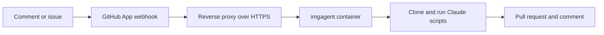

# IMGAgent

IMGAgent is the GitHub bot of the Industrial Mathematics Group, run as one small container. People write a command in an issue or a comment, GitHub sends the event to the IMGAgent server, and IMGAgent answers as `imgagent[bot]`.

## What it does

| Command | Where | What happens |
|---|---|---|
| `@IMGAgent signoff` and your words | New issue or issue comment | Claude turns your words into the answers of the signoff form. IMGAgent opens a `SIGNOFF.toml` pull request, or asks what is missing. |
| `@IMGAgent ask <folders> [with <folders>]` and a question | Start of a comment, or a new issue | Claude answers from the files in those folders, for example `docs` or `docs,src`. |
| `@IMGAgent update <folders> [with <folders>]` and a task | Start of a comment | Claude edits existing files in the folders and at the top level, reading the `with` folders. IMGAgent opens a pull request. |
| `@IMGAgent make docs [with <folders>]` and a hint | Start of a comment | Claude rebuilds `docs/` from the code. IMGAgent opens a pull request. |
| `@IMGAgent help` | Start of a comment | The list of commands. |
| The issue form *Signoff: declare or attest files* | New or edited issue | IMGAgent opens the `SIGNOFF.toml` pull request without AI. This can be switched off with `IMGAGENT_SIGNOFF_FORM`. |

The handle after `@` is `IMGAgent` by default and can be changed with `IMGAGENT_HANDLE`. Details for each command are on the [commands](reference/commands.md) page.

## Who gets an answer

IMGAgent only answers people with write, maintain or admin permission on the repository, and never answers bots. It also only answers installations on the accounts listed in `IMGAGENT_ALLOWED_OWNERS`. See [access control](reference/allowed-owners.md).

Nothing is pushed to a default branch. Every change is a pull request that a person reviews, ticks and merges. Repositories need no workflow files.

## How a command is handled

1. GitHub sends the event to `https://<your-domain>/webhook`, signed with the webhook secret.
2. The server verifies the signature, checks the owner and routes the event to at most one job. It answers GitHub right away and runs the job in the background.
3. The job gets an installation token for the repository, which expires after an hour, and works in a temporary clone that is deleted afterwards.
4. The Claude work is done by the scripts in `scripts/`. The server itself only receives events, fetches tokens, clones repositories and talks to GitHub.
5. IMGAgent opens a pull request, assigns the person who asked, and replies in the issue with a link.

!!! note
    The models have no tools. They return text or a fixed JSON structure, which the scripts check. The repository's code is read, never run.

## Set it up

Follow the pages in order:

1. [Setup overview](getting-started/index.md)
2. [Reserve the @IMGAgent name](getting-started/reserve-name.md)
3. [Register the GitHub App](getting-started/github-app.md)
4. [Run the container](getting-started/deploy.md)
5. [Expose the webhook to GitHub](getting-started/expose.md)
6. [Prepare a repository](getting-started/per-repository.md)

For all settings, see the [configuration reference](reference/index.md). If something does not answer, see [troubleshooting](operations/troubleshooting.md).
