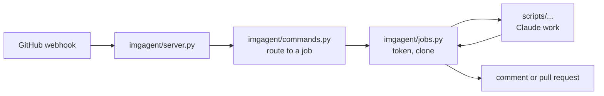

# Development

This page explains how to set up a local environment, run the tests, and keep the copied bot scripts in step with the organisation's workflows. It also describes how the code is split between the server in `imgagent/` and the Claude scripts in `scripts/`.

## Layout

IMGAgent has two parts. The server receives webhook events and talks to GitHub. The scripts do the Claude work.

| Path | What it does |
|---|---|
| `imgagent/server.py` | The webhook server. It checks GitHub's signature, answers within GitHub's 10 seconds, and runs the job in the background. It serves `POST /webhook` and `GET /healthz`. |
| `imgagent/commands.py` | Turns a webhook event into at most one job. It has only pure functions and makes no network calls, so it is easy to test. |
| `imgagent/jobs.py` | Runs each command. It fetches tokens, makes a temporary clone of the repository, starts the matching script as a subprocess with the environment that script expects, and comments or opens the pull request. |
| `imgagent/github.py` | GitHub App authentication (JWTs, installation tokens) and a small REST client. It uses the standard library and PyJWT. |
| `scripts/repo/ask.py` | Answers a question for `ask`. |
| `scripts/repo/update.py` | Edits existing files for `update`. |
| `scripts/repo/common.py` | Code shared by `ask.py` and `update.py`: which files of a target are read, and the calls to Claude. |
| `scripts/docs/write_docs.py` | Builds `docs/` and the nav in `zensical.toml` for `make docs`. |
| `scripts/signoff/assistant.py` | The signoff assistant for `@IMGAgent signoff`. |
| `scripts/signoff/request.py` | Turns the signoff form answers into a `SIGNOFF.toml` pull request. |

The scripts are the same code the GitHub Actions versions of these bots ran:

- `scripts/docs/` comes from agent-sandbox's docs bot.
- `scripts/repo/` holds `ask` and `update`.
- `scripts/signoff/` is extracted from the Signoff-Assistant and Signoff-Request workflows of `industrial-mathematics-group/.github`.

`imgagent/jobs.py` starts each script with only the environment variables it needs, plus `PATH`, `HOME`, `LANG` and `SSL_CERT_FILE` when they are set. It logs the script's output line by line. For the signoff scripts it recreates what a GitHub Actions run would provide: `GITHUB_EVENT_PATH`, `GITHUB_REPOSITORY`, `GITHUB_TOKEN`, `GITHUB_API_URL`, `GITHUB_SERVER_URL` and a `GITHUB_OUTPUT` file.



## Set up a local environment

```bash
python -m venv .venv && . .venv/bin/activate
pip install -r requirements.txt pytest
```

`requirements.txt` pins these packages:

| Package | Version |
|---|---|
| `anthropic` | `2.8.0` |
| `aisignoff` | `1.0.0rc8` |
| `PyJWT[crypto]` | `2.15.1` |

The container image uses Python 3.13 (`python:3.13-slim`) and installs `git` for the clones.

## Run the tests

```bash
python -m pytest tests
```

The tests in `tests/` cover:

- routing events to commands, and checking command targets
- the webhook signature check
- the HTTP server
- which files `ask` and `update` read and which they may change
- the branch, commit and pull request of `make` and `update`

The tests use a local git repository in place of GitHub.

!!! note
    `.dockerignore` leaves out `tests/`, `.venv/`, `.env` and `*.pem`, so none of these end up in the container image.

## Run a script on its own

Each Claude script can also run directly from the root of a repository. The scripts that write files change the working tree, so review the result with `git diff`. For example:

```bash
pip install anthropic
export ANTHROPIC_API_KEY=sk-ant-...
TARGETS=docs,src python path/to/imgagent/scripts/repo/ask.py "How do I add a host to the allowlist?"
TARGETS=docs CONTEXT=src python path/to/imgagent/scripts/repo/update.py "fix what is outdated"
python path/to/imgagent/scripts/docs/write_docs.py make "optional hint for Claude"
```

Without `SUMMARY_FILE` (for `update.py` and `write_docs.py`) or `ANSWER_FILE` (for `ask.py`), the script prints its result instead of writing it to a file. The [ask](../usage/ask.md), [update](../usage/update.md) and [make docs](../usage/make-docs.md) pages list each script's environment variables.

## Keep the signoff scripts in sync

`scripts/signoff/assistant.py` and `scripts/signoff/request.py` are copied unchanged from the Python steps of two workflows in `industrial-mathematics-group/.github`. When those bots change there, update the copies:

1. Copy the Python step of `.github/workflows/signoff-assistant.yml` into `scripts/signoff/assistant.py`.
2. Copy the Python step of `.github/workflows/signoff-request.yml` into `scripts/signoff/request.py`.
3. Keep the header comment at the top of each file. It records where the code comes from and how IMGAgent runs it.
4. In `requirements.txt`, bump `aisignoff` to the organisation's version.

Both signoff scripts read the variable `SIGNOFF_DRY_RUN=1`. With it set, they print the GitHub API calls instead of making them, which is useful for testing outside Actions.

## Update a running server

After changes are merged, update the server as described in [Run the container](../getting-started/deploy.md):

```bash
git pull
docker compose up -d --build
```
