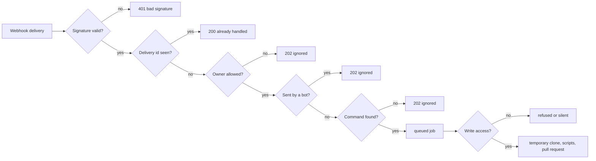

# Security model

IMGAgent receives events from GitHub, clones repositories and runs Claude on their contents. This page explains which checks keep strangers, bots and malicious text from making it do something unintended, and where the secrets live.

## Who can reach the server

### Signed webhooks only

Every `POST /webhook` must carry an `X-Hub-Signature-256` header. The server computes `sha256=` plus the HMAC-SHA256 of the raw body with `IMGAGENT_WEBHOOK_SECRET` and compares it in constant time (`hmac.compare_digest`). A missing or wrong signature gets `401 bad signature` and a log line `rejected a delivery with a bad signature from <address>`. The signature is checked before the body is parsed as JSON.

Bodies that are empty or larger than 25 MB are refused with `400 bad length` before they are read.

### Redeliveries are ignored

The server remembers the `X-GitHub-Delivery` id of the last 1000 deliveries. A delivery with an id it has already seen gets `200 already handled` and starts nothing. This stops a replayed or redelivered event from running a command twice.

!!! note
    The list of seen ids is kept in memory, so it starts empty after a restart.

### Only allowed accounts

The App can be installed by any account, so the server only answers installations whose repository owner is listed in `IMGAGENT_ALLOWED_OWNERS` (comma-separated, compared case-insensitively). Events from other owners get `202 ignored: owner <owner> is not in IMGAGENT_ALLOWED_OWNERS` and a warning in the log. A `*` in the list allows every owner. Events without a repository or installation are also ignored.

This keeps people who install the App on their own accounts from spending your Claude credit.

## Who is answered

### Never bots

Any event whose sender has type `Bot` is ignored. This includes IMGAgent itself, so its own comments and pull requests can never start another command.

### Only people with write access

Before doing any work, each command checks the sender's permission on the repository through the GitHub API (`/repos/<repo>/collaborators/<login>/permission`). Only `admin`, `maintain` and `write` are accepted.

| Command | Without write access |
|---|---|
| `ask`, `update`, `make` | a comment: `` `<command>` is only for people with write access to this repository.`` |
| `help` | no reply, so a stray `@IMGAgent` from anyone does not make the bot talk |
| `signoff` | the assistant replies that it only answers people with write access |
| the signoff issue form | a comment that only people with write access can request a signoff |

The signoff assistant applies the same check to the conversation it reads: messages in the issue by people without write access are left out of what the model sees.

### Commands in code and quotes don't count

Mentions of `@IMGAgent` inside fenced code blocks or quoted lines (`>`) are not read as commands. Zero-width characters are removed before matching, so they cannot be used to hide or split a command.

### Edits run a command once

Editing a comment only runs its command if the text before the edit had no command (or only an invalid one). Editing or reopening an issue only runs its command while IMGAgent has not commented on that issue yet. This prevents repeated edits from repeating the work.

## What the jobs can do

### Comment text never reaches a shell

The question, task or hint is passed to the scripts as environment variables (`QUESTION`, `TASK`) or as a single command-line argument to a Python process, never through a shell. Each script runs with only the environment it needs, plus `PATH`, `HOME`, `LANG` and `SSL_CERT_FILE` from the server.

### The repository's code is read, not run

The scripts read the tracked text files of the clone and send them to Claude. Nothing from the repository is executed. The signoff scripts run the `aisignoff` tool on `SIGNOFF.toml`, which is installed in the image, not taken from the repository.

### The models have no tools

Claude gets text in and returns either text or JSON in a fixed schema; it cannot run commands or change files on its own. The scripts check what comes back:

- `make docs` refuses page paths that are not lowercase relative `.md` paths (for example `concepts/gateway.md`), requires an `index.md` and no duplicates, and checks that the new `zensical.toml` reads back with the planned nav before writing it.
- `update` only applies find-and-replace edits whose text occurs exactly once in the file, and only in files it was allowed to edit.
- The signoff assistant's answers are checked against the same rules as the issue form and by `aisignoff` itself. Text from the model is made harmless before it is posted: HTML comment markers are escaped, and `@` mentions of anyone but the requester are broken with a zero-width space.

The prompts tell Claude to treat the repository's files and the comment text as material, not as instructions.

### Paths are checked twice

Folders named in a command are checked first by name when the command is read. Each comma-separated entry must be a relative path made of plain names; these are refused:

- `..` and `.` segments, and empty segments
- absolute paths
- `.git` in any position
- glob and other special characters (each segment must match letters, digits, `.`, `_` and `-`)
- paths longer than 200 characters

Then, in the clone, each path must exist and resolve to a location inside the repository, also when it goes through a symlink. Missing paths get a reply naming them. When reading files, the scripts also skip symlinks, binary files and files over 200,000 bytes.

### `update` commits only what it may change

After `update` runs, IMGAgent commits only tracked files that were modified (`git diff --diff-filter=M`) and that are under a target folder or at the top level of the repository. It never commits:

- new, deleted or renamed files
- files in the `with` folders
- anything under `.github/workflows/`

Any other changes left in the clone are logged as `leaving out changes outside its scope` and stay out of the pull request. `make docs` commits only `docs/` and `zensical.toml`.

### Nothing is pushed to a default branch

`make` and `update` push a new branch under `<slug>/` and open a pull request; the signoff scripts push `signoff-request/issue-<n>`. A person reviews, ticks the review level in the description and merges. The App has no Workflows permission, so even a push that touched `.github/workflows/` would be refused by GitHub.

## Where the work happens

### Temporary clones

Every job clones the repository into a new temporary directory under `/tmp`, which is deleted when the job ends. `ask` makes a shallow sparse clone of only the named paths and `.github/imgagent.toml`.

### An unprivileged, read-only container

`compose.yaml` and the `Dockerfile` set up the container so that a compromised job has little to work with:

| Setting | Effect |
|---|---|
| `USER imgagent` (uid 10001) | the server and scripts don't run as root |
| `read_only: true` | the root file system cannot be written |
| `tmpfs: /tmp:size=2g` | the only writable place: clones and git's config, gone on restart |
| `no-new-privileges:true` | processes cannot gain privileges, e.g. through setuid binaries |
| `127.0.0.1:${IMGAGENT_PORT:-8080}:8080` | the port is only reachable from the host, for a reverse proxy |
| `tini` as PID 1 | reaps the git and script subprocesses |

`GIT_TERMINAL_PROMPT=0` keeps git from ever waiting for credentials.

### Short-lived tokens

IMGAgent never holds a personal access token. It signs a JWT with the App's private key (valid for about ten minutes) and exchanges it for an installation token, which GitHub limits to the repositories of that installation and expires after an hour. Before pushing a branch, `make` and `update` fetch a fresh token, since a long run may outlast the first one.

## Where the secrets live

The Claude API key and the App's private key exist only on the server, in `.env` and `imgagent.pem` next to `compose.yaml`. Both are listed in `.gitignore` and `.dockerignore`, so they are neither committed nor copied into the image. The private key is mounted into the container as a compose secret at `/run/secrets/imgagent_private_key`; see [Private key](../reference/private-key.md).

!!! tip
    Use a Claude Console API key from a workspace with a spend limit, so a misuse that gets past these checks has a bounded cost.

Related pages: [HTTP endpoints](../reference/http-endpoints.md), [Environment variables](../reference/index.md), [Commands](../usage/index.md).
