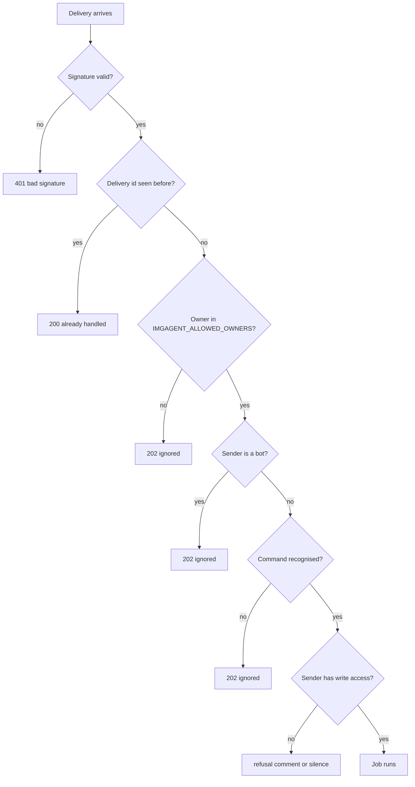

# Access control and allowed owners

IMGAgent answers only requests that pass four checks: a valid signature, an allowed owner, a person with write access, and a sender that is not a bot. This page describes each check and where it runs.

## Why there are several checks

The GitHub App is installable by any account. Anyone who installs it sends events to your server, and every command that reaches Claude costs money on your `ANTHROPIC_API_KEY`. The checks keep strangers from spending your credit, and keep the bot from answering itself.

## The checks, in order



### 1. Signature

Every delivery must carry an `X-Hub-Signature-256` header: an HMAC-SHA256 of the request body, made with `IMGAGENT_WEBHOOK_SECRET`. A delivery without a valid signature gets `401 bad signature` and is not processed.

### 2. Repeated deliveries

The server remembers the last 1000 delivery ids (`X-GitHub-Delivery`). A delivery whose id it has already seen gets `200 already handled` and does nothing. Redelivering from the App's *Recent Deliveries* page therefore does not run a command twice, as long as the server has not restarted and the id is still among the last 1000.

### 3. Allowed owners

`IMGAGENT_ALLOWED_OWNERS` is a comma-separated list of account names, compared case-insensitively against the owner of the repository in the event.

```bash
IMGAGENT_ALLOWED_OWNERS=industrial-mathematics-group
IMGAGENT_ALLOWED_OWNERS=org-one,org-two
```

| Case | Result |
|---|---|
| Owner is in the list | The event goes on to routing |
| Owner is not in the list | `202`, ignored; a warning is logged |
| The list contains `*` | Every owner is allowed |
| Event has no repository or installation | `202`, ignored |

The variable is required: the server refuses to start without it.

!!! warning
    Use `*` only if you want every account that installs the App to be able to spend your Claude credit. Normally list the accounts you own.

At startup the server also warns if an owner in the list has no installation of the App.

### 4. Bots are never answered

Events whose sender has type `Bot` are dropped without a reply. This stops IMGAgent, and any other bot, from triggering the bot through comments it posts itself.

### 5. Write access

For commands that act, the server asks GitHub for the sender's permission on the repository. Only `admin`, `maintain` and `write` count. Read, triage or no access do not.

| Command | Without write access |
|---|---|
| `docs ask`, `docs make`, `docs update` | The bot comments that the command is only for people with write access |
| `help` | No reply, so that mentioning the bot does not make it talk |
| `signoff` in a comment or new issue | The assistant comments that it only answers people with write access |
| the signoff issue form | The request script comments that only people with write access can request a signoff |

The signoff assistant also applies the check to the conversation it reads: messages from people without write access are left out of what Claude sees, so they cannot steer the answers.

## What is not checked

The write-access check covers the person who wrote the command. It does not make the result trusted: every change arrives as a pull request that a person reviews and merges, and nothing is pushed to a default branch.

See [commands](commands.md) for the commands themselves and [troubleshooting](../operations/troubleshooting.md) for what the `202` messages in *Recent Deliveries* mean.
