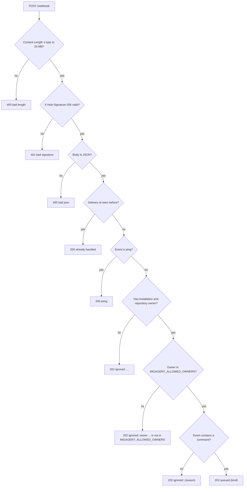

# HTTP endpoints

The IMGAgent server has two endpoints: one for GitHub's webhook deliveries and one for health checks. This page describes what each endpoint accepts and returns, and how accepted deliveries become jobs.

The server is a threaded HTTP server that listens on `0.0.0.0` on the port in `PORT` (default `8080`). In the container, `compose.yaml` publishes that port on `127.0.0.1:${IMGAGENT_PORT:-8080}` for a reverse proxy. See [Expose it to GitHub](../getting-started/expose.md).

| Method | Path | Purpose |
|---|---|---|
| `POST` | `/webhook` (also `/webhook/` and `/`) | GitHub App webhook deliveries |
| `GET` | `/healthz` and `/` | Health check, returns `ok` |

Any other path returns `404 not found`. Every response is plain text (`text/plain; charset=utf-8`) followed by a newline, and the `Server` header is `IMGAgent`.

## GET /healthz

The server returns `200 ok`. The container's `HEALTHCHECK` in the `Dockerfile` calls `http://127.0.0.1:$PORT/healthz` every 30 seconds with a 5 second timeout.

## POST /webhook

GitHub expects an answer within 10 seconds, but a Claude job can take much longer. The server therefore checks the delivery, decides whether it starts a job, answers right away, and runs the job in the background.

The checks run in this order:

### Request size

The `Content-Length` header must be greater than zero and at most 25 MB, which is GitHub's limit for webhook payloads. Otherwise the server answers `400 bad length`.

### Signature

The server computes the HMAC-SHA256 of the raw request body with `IMGAGENT_WEBHOOK_SECRET` and compares it, in constant time, with the `X-Hub-Signature-256` header (`sha256=<hex digest>`). A missing or wrong signature gets `401 bad signature`, and the server logs a warning with the client's IP address. A delivery without a valid signature never reaches the rest of the checks.

### Headers used

`X-GitHub-Event`
:   The event name, such as `issues`, `issue_comment` or `ping`.

`X-GitHub-Delivery`
:   The delivery id, used to recognise redeliveries.

`X-Hub-Signature-256`
:   The signature described above.

### Responses

| Status | Text | When |
|---|---|---|
| `200` | `already handled` | A delivery with this id was accepted before |
| `200` | `pong` | The `ping` event GitHub sends when the App is created |
| `202` | `ignored: <event> has no repository or installation` | The payload has no `installation` or no repository owner |
| `202` | `ignored: owner <owner> is not in IMGAGENT_ALLOWED_OWNERS` | The repository's owner is not allowed |
| `202` | `ignored: <reason>` | The event contains no command IMGAgent acts on |
| `202` | `queued <kind>` | A job was started: `ask`, `update`, `make`, `signoff`, `signoff-form` or `help` |
| `400` | `bad length` | Empty body or body over 25 MB |
| `400` | `bad json` | The body is not valid JSON |
| `401` | `bad signature` | Signature missing or wrong |
| `404` | `not found` | Any other path |

GitHub shows these texts under the App's *Advanced → Recent Deliveries*. The server also logs each delivery as `delivery <id> <event>.<action>: <text>`.

An owner is allowed when its login (compared case-insensitively) is listed in `IMGAGENT_ALLOWED_OWNERS`, or when that list contains `*`. See [Environment variables](index.md).

### Reasons for ignored events

When an event starts no job, the text after `ignored:` says why:

- `sent by the bot <login>`: IMGAgent never answers bots, including itself.
- `IMGAgent doesn't use <event> events`: only `issues` and `issue_comment` are read.
- `<event>.<action> by <login>: no @IMGAgent in '<start of text>'`: the comment or issue body does not mention the handle.
- `... @IMGAgent found, but commands in an issue are only read when it is opened, edited or reopened`
- `... @IMGAgent found, but neither title nor body changed, or there is no command in them, in '...'`
- `... @IMGAgent found, but the edit didn't turn a comment without a command into one in '...'`
- `... @IMGAgent found, but <event>.<action> events are not read`
- `... @IMGAgent found but no command: write `@IMGAgent <ask|update|make|help> ...` (not in code or a quote); signoff only in open issues; in '...'`

The handle in these messages is `IMGAGENT_HANDLE` (default `IMGAgent`). For the command rules themselves, see [Commands](../usage/index.md). [Troubleshooting](../operations/troubleshooting.md) explains how to use these reasons.

## Redeliveries

The server remembers the ids of the last 1000 deliveries in memory. A delivery whose id is among them is answered with `200 already handled` and starts nothing, so pressing *Redeliver* in GitHub, or GitHub retrying a delivery, does not run a command twice. The list is lost when the server restarts.

## Jobs and ordering

Accepted jobs run on a thread pool with `IMGAGENT_WORKERS` threads (default `2`), so at most that many jobs work at the same time.

Each job also has a key, and jobs with the same key run one after the other:

| Job | Key | Effect |
|---|---|---|
| `make`, `update` | `<owner>/<repo>#write` | Jobs that open pull requests in the same repository never overlap |
| all others | `<owner>/<repo>#<issue number>` | Jobs on the same issue or pull request run in order |

Jobs with different keys can run in parallel, up to the number of workers. A job that waits for another job with the same key already occupies a worker thread while it waits.
