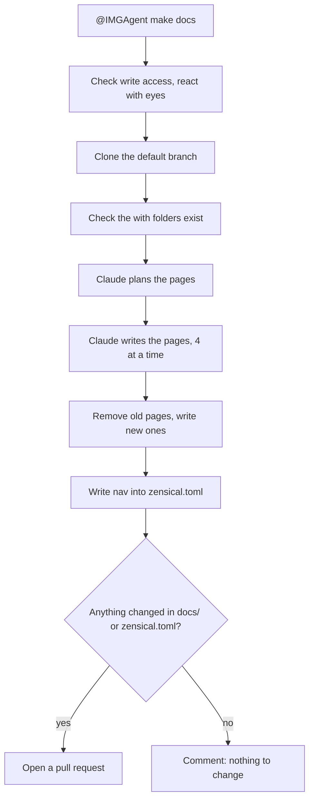

# make docs

`@IMGAgent make docs` rebuilds the documentation site in `docs/` from the repository's code and opens a pull request with the result. It writes a [Zensical](https://zensical.org) site: Markdown pages in `docs/` and the navigation in `zensical.toml`.

Use it to create documentation from scratch or to regenerate it after larger changes. For small corrections to existing pages, use [`update docs with src`](update.md) instead: `make docs` replaces every page.

## Writing the command

```
@IMGAgent make docs
focus on deployment; the audience runs it on their own servers
```

```
@IMGAgent make docs with src,examples
```

- `make` only accepts the target `docs`. Any other target gets a help reply suggesting `update <folders>` instead.
- `with <folders>` limits what Claude reads to those folders plus the files at the top level of the repository (`README.md`, `pyproject.toml`, ...). Without `with`, Claude reads all of the code.
- The rest of the text is a hint. It is passed to Claude as guidance from the maintainer when it plans the site. It is optional.

The general command syntax, and who may use it, is described on [Commands](index.md).

## What happens



1. **Checks.** IMGAgent answers only people with write, maintain or admin permission. It reacts to the comment and looks up its own bot identity before the long Claude run, so a problem there fails quickly.
2. **Clone.** It clones the default branch into a temporary directory. If a folder named after `with` does not exist (or leads outside the repository through a symlink), it replies `there is no ... in this repository` and stops.
3. **Reading the code.** The script reads every tracked text file, in a stable order, except:
    - anything under `docs/`,
    - files named `*.whl`, `LICENSE`, `NOTICE`, `*.png`, `*.jpg`, `*.svg`, `*.ico`,
    - files larger than 200,000 bytes,
    - binary files (files containing a null byte),
    - with `with <folders>`: anything that is neither under those folders nor at the top level.
4. **Planning.** One call to Claude returns the list of pages in reading order. Each page has a path under `docs/`, a nav section, a title and a short brief. Paths must be lowercase, made of letters, digits, `-` and `_`, and end in `.md` (for example `concepts/gateway.md`). The plan must contain `index.md` and no duplicate paths, otherwise the run fails.
5. **Writing.** Each page is written in a separate call that sees the whole plan, so pages don't overlap. Up to four pages are written in parallel. The code is sent once and then read from the prompt cache by the following calls.
6. **Replacing pages.** Every Markdown file under `docs/` that is not in the new plan is deleted. Other files in `docs/` (images and other assets) stay. Then the new pages are written.
7. **Navigation.** The nav is built from the plan: a page without a section becomes a top-level entry, and pages with a section are grouped under that section in the order they appear.
8. **Pull request.** If `git status` shows changes in `docs/` or `zensical.toml`, IMGAgent commits exactly those paths (new, changed and deleted files) and opens a pull request. If nothing changed, it comments with the first line of the summary.

!!! warning "Hand-written pages are replaced"
    `make docs` is a full rebuild. Pages you wrote by hand are overwritten or removed unless the new plan keeps them. Check the list of removed pages in the pull request, and restore what you want to keep during review.

## zensical.toml

The nav is written into `zensical.toml` in one of these ways:

| Situation | What happens |
|---|---|
| No `zensical.toml` | A complete file is created: `site_name`, `site_description`, `site_url`, `repo_url`, `repo_name`, the nav, theme features, light and dark palettes, and the Markdown extensions the pages may use (admonitions, tabs, details, footnotes, definition lists, tables, Mermaid, ...). |
| `nav = [...]` in `[project]` | Only that assignment is replaced; the rest of the file stays as it was. |
| `[project]` without `nav` | The nav is added right after the `[project]` header. |
| No `[project]` table | A `[project]` table with the nav is added at the top. |

The new file is parsed again before it is saved. If it doesn't read back with the planned nav, `zensical.toml` is left alone, the pages are still written, and the pull request description shows the nav block to paste by hand.

For a new file, `site_name` is the project name, `site_description` is the project description (or the name), `site_url` is the documentation URL and `repo_url`/`repo_name` point to the GitHub repository. These come from the [repository settings file](../reference/repo-config.md) and the repository on GitHub; by default the URL is `https://<owner>.github.io/<repo>/`, and `url = "none"` leaves `site_url` out.

## The pull request

| | |
|---|---|
| Branch | `<app-slug>/make-docs-<8 hex characters>` |
| Title | `docs: make documentation from the code` |
| Commit author | `<app-slug>[bot]` |
| Description | the organisation's PR template, with the summary of the run |

The summary lists the number of pages, each page with its brief, the pages that were removed, what was done to `zensical.toml`, and the tokens used. The requester is assigned and asked to review every page before merging. See [Pull requests](pull-requests.md) for the template and the AI declaration.

`make` and `update` jobs in the same repository run one after another, never at the same time.

## Model and settings

`make docs` uses `WRITER_MODEL` (default `claude-opus-5-5`) with `WRITER_EFFORT` (default `medium`), the same as `update`. See [Environment variables](../reference/index.md).

The run is stopped after 45 minutes. It fails if Claude declines a request or an answer hits the token limit; for Opus 5, Sonnet 5.5 and Fable 5 models, a refusal by a safety classifier is first retried on a fallback model by the API. When a run fails, IMGAgent comments that it couldn't finish, and the details are in the server log ([Troubleshooting](../operations/troubleshooting.md)).

What Claude is told about the project (name, one-sentence description, audience) can be set per repository in [`.github/imgagent.toml`](../reference/repo-config.md).

## Running the script locally

`scripts/docs/write_docs.py` can run without IMGAgent. Run it from the root of the repository to document; it needs `git` and edits the working tree, so review the result with `git diff`.

```bash
pip install anthropic
export ANTHROPIC_API_KEY=sk-ant-...
python path/to/imgagent/scripts/docs/write_docs.py make "optional hint for Claude"
```

Without `docs/` or `zensical.toml`, both are created. Without `SUMMARY_FILE`, the summary is printed to standard output; progress and token counts go to standard error.

| Variable | Meaning | Default |
|---|---|---|
| `REPO_ROOT` | the repository to document | the current directory |
| `DOCS_PROJECT` | the project's name | the folder name of `REPO_ROOT` |
| `DOCS_ABOUT` | one sentence on what the project is | none |
| `DOCS_AUDIENCE` | who reads the docs | `people who use <project>` |
| `DOCS_URL` | `site_url` for a new `zensical.toml` | none |
| `DOCS_REPO` | `owner/name`, for `repo_url` and `repo_name` in a new `zensical.toml` | none |
| `CONTEXT` | comma-separated paths to document (plus the top-level files) | all code |
| `WRITER_MODEL` | model id (`DOCS_WRITER_MODEL` also works) | `claude-opus-5-5` |
| `WRITER_EFFORT` | `low`, `medium`, `high`, `xhigh` or `max` (`DOCS_WRITER_EFFORT` also works) | `medium` |
| `SUMMARY_FILE` | where to write the Markdown summary | printed instead |

## Previewing and publishing

To look at the site before merging, check out the pull request's branch and run Zensical:

```bash
pip install zensical
zensical serve            # preview on http://localhost:8000
zensical build --clean    # static site in site/
```

IMGAgent does not add a GitHub Pages workflow: the App has no permission to change `.github/workflows/`. Add the workflow by hand once; see [Per-repository setup](../getting-started/per-repository.md).
