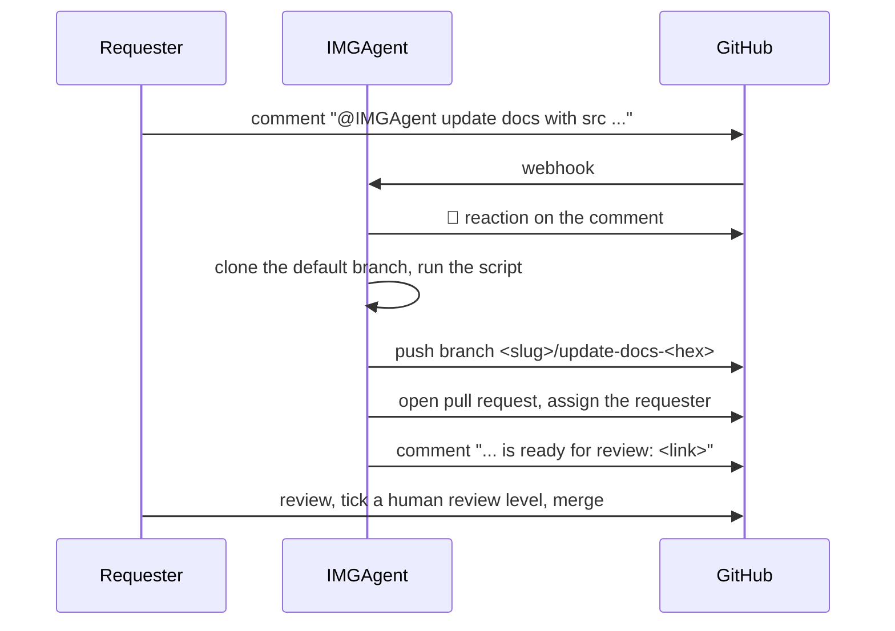

# Pull requests

`make docs` and `update` never push to the default branch. They commit their changes on a new branch, open a pull request against the default branch, and assign it to the person who asked. This page describes those pull requests and what the requester does with them.

The signoff pull requests are built differently, by the signoff scripts. They are described in [signoff](signoff.md).

## From command to pull request

When the job starts, IMGAgent adds an `eyes` reaction to the comment. If the command was written in a new issue, there is no comment to react to. Before the long Claude run, IMGAgent looks up the App's slug and the id of its bot user. A problem with that lookup then fails the job within seconds and does not waste the written pages.

After the script has run, IMGAgent:

1. creates the branch with `git switch -c`,
2. stages the allowed paths and commits them as the App's bot user,
3. gets a fresh installation token and pushes the branch, because a long run can outlast the first token,
4. opens the pull request against the repository's default branch,
5. assigns the requester to the pull request. If that fails, IMGAgent logs a warning and continues.
6. comments on the issue: `@<requester> \`<command>\` is ready for review: <pull request URL>`.

Jobs that open pull requests run one after the other within a repository, so two of them never work on the same repository at the same time. See [HTTP endpoints](../reference/http-endpoints.md).

## When nothing changes

If the script leaves nothing to commit, IMGAgent opens no pull request. It replies with the first line of the script's summary instead:

| Command | Reply when nothing changed |
|---|---|
| `make docs` | `` @<requester> `make docs`: `` and the first summary line, or `nothing to change.` |
| `update` | `` @<requester> `update <folders>`: `` and the first summary line, or `nothing needed to change.` |

## Branches

All branches start with the App's slug, followed by a random suffix of 8 hex characters:

| Command | Branch |
|---|---|
| `make docs` | `<slug>/make-docs-<hex>` |
| `update <targets>` | `<slug>/update-<name>-<hex>` |

For `update`, `<name>` is built from the target folders. They are joined with `-` and lowercased, every run of other characters than `a-z` and `0-9` becomes `-`, and the result is cut to 40 characters. If nothing is left, `<name>` is `repo`. For example, `update docs,src/pkg` gives `<slug>/update-docs-src-pkg-1a2b3c4d`.

## What is committed

| Command | Staged paths |
|---|---|
| `make docs` | `docs` and `zensical.toml`, including new and removed pages |
| `update` | only modified tracked files under the target folders or at the top level, never `.github/workflows/` |

For `update`, new, deleted or other files the script may have left in the clone stay out of the commit. IMGAgent logs them as changes outside the command's scope. Files in the `with` folders are never committed. See [update](update.md).

## Commits

Each pull request has a single commit, authored as the App's bot account so that GitHub shows its name and avatar:

- name: `<slug>[bot]`
- email: `<bot id>+<slug>[bot]@users.noreply.github.com`
- subject: the pull request title
- body: `Written by <model> on <default branch>, requested by @<requester> in <URL>`

`<model>` is the writer model (`WRITER_MODEL`, default `claude-opus-5-5`, see [Environment variables](../reference/index.md)). The URL is the comment with the command. For a command in a new issue, it is the issue.

## Titles

| Command | Title |
|---|---|
| `make docs` | `docs: make documentation from the code` |
| `update <targets>` | `<targets, comma-separated>: <task>` |

The task in an `update` title has its whitespace collapsed to single spaces. If it is longer than 60 characters, it is cut to 57 characters and ends with `...`.

## The description

The description follows the organisation's pull request template, already filled in. The PR-signoff check can therefore read it. Because the pull request is opened by a GitHub App, it also starts the repository's normal checks.

### What does this PR change?

This section contains:

- `Requested by @<requester> in <URL> (\`<command>\`).`
- the script's summary. For `update`, the summary starts with `Task: <task>`. It ends with a small line that shows the model, the effort and the tokens used.
- a review note:
  - `make docs`: "Review every page before merging: Claude was told to document only what the code shows, but it can still be wrong."
  - `update`: "Claude could only edit existing files in `<targets>` and at the top level of the repository. Review every change before merging: it can still be wrong."

### AI declaration

The declaration names the requester as `Responsible person: @<requester>`. Part of it is already ticked:

| Part | Pre-filled |
|---|---|
| Generation | **G3** AI-autonomous |
| AI models | the family of the writer model: **Claude Opus**, **Claude Sonnet** or **Claude Fable**, chosen by whether the model id contains `opus`, `sonnet` or `fable`. Any other model ticks **Other** and names the model id. |
| Human review | nothing ticked |
| AI review | **A0** No independent AI review |
| AI-Review-Findings | empty |

With the default `claude-opus-5-5`, **Claude Opus** is ticked.

## What the requester does

The requester is responsible for the change. Before merging:

1. Read the changes. Claude can be wrong, also when told to document only what the code shows.
2. Tick the highest human review level you completed in the description, at least **H0**. IMGAgent leaves all of them empty.
3. If an independent AI review was done, change the AI review level and fill in the model and report as the template asks.
4. Merge, or close the pull request and delete the branch.

!!! note
    You can push your own fixes to the branch before merging. IMGAgent does not touch the branch again after it opened the pull request.
