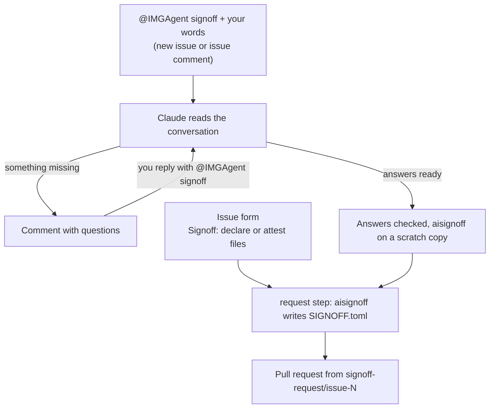

# signoff

`@IMGAgent signoff` records how files were made and reviewed in the repository's `SIGNOFF.toml`. You describe it in your own words, Claude turns that into the answers of the signoff form, and IMGAgent opens a pull request that you review. The issue form *Signoff: declare or attest files* leads to the same pull request without AI.

Both paths end in the same step: the answers are checked, `aisignoff` writes them into `SIGNOFF.toml` on a branch, and a pull request is opened for the requester to review and merge.



## What a repository needs

- A `SIGNOFF.toml` at the root of the default branch. A maintainer creates it once with `aisignoff init`. Without it, both paths stop and say so.
- Nothing else. If the repository still has the GitHub Actions versions of these bots, delete the Signoff-Assistant caller, and the Signoff-Request caller while `IMGAGENT_SIGNOFF_FORM` is on, so two bots don't answer the same issue. See [Per-repository setup](../getting-started/per-repository.md).

## What can be recorded

The form, and so the assistant, records one of three kinds:

| Kind | Form answer | Needs |
|---|---|---|
| `annotate` | Declare files: how they were made and reviewed (an annotation) | at least one path, and all three levels: generation, human check and AI review |
| `attest` | Raise the review of files I checked as they are now (an attestation, needs `[history]`) | at least one path, and a human review, an AI review or both; no generation level and no models |
| `commit` | Correct the declaration of a commit (`[[commits]]`, needs `[history]`) | a commit hash (4 to 40 hex digits) that exists in the repository, no paths, and at least one level to correct |

Paths are relative to the repository root. A folder ends with `/` and covers everything in it; globs such as `notebooks/*.ipynb` are allowed.

### Levels

Each axis has one level. The human and AI review levels build on each other: declare the highest one completed.

Generation (the highest level of any substantial part)
:   **G0** a human wrote it without AI · **G1** a human wrote it, AI suggested or edited parts · **G2** AI wrote substantial parts, a human directed the work and edited the result · **G3** an AI agent produced it largely end to end

Human review
:   **H0** checked the result as a whole: it does what was asked and the output is plausible · **H1** ran it or reproduced the key results, and read the important parts · **H2** read every line, understood it, checked edge cases · **H3** validated it independently: new tests, a reference solution or method, or a second person's review

AI review
:   **A0** no independent AI review (the checks of the session that wrote it don't count) · **A1** a new AI session, without the original conversation, checked it · **A2** a different, capable model did that check and committed a review report · **A3** a different, capable model validated it with new evidence, committed with the report

The answers must also fit together:

- G1 to G3 need the AI tools and models that wrote parts, e.g. `Claude Opus 5.5 (Anthropic)`. Models go only with G1 to G3.
- A1 to A3 need the reviewing model and how it reviewed. A reviewing model goes only with A1 to A3.
- A human level needs the full name of the person who did the check (recorded as `Reviewed-by`). A responsible person goes only with a human level.
- The `[policy]` of `SIGNOFF.toml` may require minimum levels for some paths; `aisignoff` enforces it.

## The assistant: `@IMGAgent signoff`

Write `@IMGAgent signoff` and, in your own words, what to record:

```text
@IMGAgent signoff
I wrote src/solver/ with Claude Opus 5.5 doing most of it, then read every line and
ran the tests. No other AI reviewed it.
```

### Where it is recognised

- In the body of a new issue, or in a comment on an open issue.
- Not in pull request comments, and not in issues made with the signoff form.
- Not inside a longer word, an e-mail address, a path or code (for example `` `@IMGAgent signoff` `` in backticks).
- Editing a comment or an issue does not run the assistant again: write a new comment instead.

Only people with write access to the repository are answered. Others get a comment saying so.

### What Claude sees

Claude (the model in `SIGNOFF_MODEL`) gets:

- the conversation: the issue's title and body and the comments before yours, newest first up to about 40,000 characters. Text from people without write access is left out; of the bots' comments only the signoff assistant's and the request step's own are included.
- the repository's folders and files (up to 300 folders and 1,500 files), the first 20,000 characters of `SIGNOFF.toml`, and the last 80 commits of the default branch.
- your login and the name on your GitHub profile. If you say you checked the files yourself and give no other name, that name may be used as the responsible person.

Claude has no tools. It returns its answers in a fixed JSON form with one of three statuses:

`ready`
:   Everything needed is stated or clearly implied.

`need_info`
:   Something is missing, ambiguous or contradictory. Claude never guesses levels, names or models; it asks at most four short questions.

`not_a_request`
:   You asked something else, such as what a level means. Claude answers briefly.

Claude answers in the language you write in.

### How the answers are checked

When Claude says `ready`, the answers go through the same checks as the form: the paths must exist on the default branch, the levels must fit together (see above), there are at most 50 paths, and each path, name and model must be one short line. Then `aisignoff annotate` or `aisignoff attest` runs on a scratch copy of the default branch, followed by `aisignoff lint`; the scratch changes are discarded.

If a check fails, Claude gets one more try with the problems listed: it fixes them from the conversation, or turns them into questions.

### The replies

- **Questions or problems:** a comment addressed to you with Claude's message, or the list of problems. Reply with `@IMGAgent signoff` and the missing details, or use the form instead.
- **Ready:** a comment with a table of the answers, then the request step below opens the pull request.

Each reply is a new comment, so the issue reads as a conversation. Mentions in Claude's text are neutralised except yours.

## The issue form

When `IMGAGENT_SIGNOFF_FORM` is on (the default), an issue made with the form *Signoff: declare or attest files* becomes a `SIGNOFF.toml` pull request directly, without AI. IMGAgent recognises the form by the heading `### What should be recorded?` in the issue body. It runs when such an issue is opened, reopened, or edited with a changed body, while the issue is open.

With `IMGAGENT_SIGNOFF_FORM=false`, IMGAgent ignores these issues and leaves them to the repository's Signoff-Request workflow.

The form's fields are:

| Field | Content |
|---|---|
| What should be recorded? | the kind, see [What can be recorded](#what-can-be-recorded) |
| Files, folders or globs | one per line |
| Commit | only for correcting a commit |
| How much of it did AI write? | G0 to G3 |
| Which AI tools and models wrote parts of it? | one per line |
| How did a human check it? | H0 to H3 |
| Responsible person | full name |
| Did an AI review it? | A0 to A3 |
| Which model reviewed it, and how? | one per line |
| Notes for the reviewer | quoted in the pull request |
| Confirmation | a box that must be ticked |

## The pull request

The request step is the same for the form and the assistant:

1. It checks that the requester has write or admin permission on the repository.
2. It reads the answers and checks them (see above); for the form, the confirmation box must be ticked.
3. It creates the branch `signoff-request/issue-<number>` from the default branch.
4. For `annotate` and `attest` it runs `aisignoff annotate` or `aisignoff attest` with the levels, models and names. For `commit` it appends a `[[commits]]` entry to `SIGNOFF.toml`.
5. It refuses the change if it changes nothing ("SIGNOFF.toml already records it"), or if `aisignoff lint` fails with it while it passed before.
6. It commits as the App's bot account, with the requester as co-author, and pushes the branch.
7. It opens the pull request, assigns the requester and requests their review.

The title says what is recorded, for example `Declare src/solver/ (signoff request #12)`. The description follows the repository's pull request template (or the organisation's from its `.github` repository) and contains the diff of `SIGNOFF.toml`, the notes from the request and `Closes #<number>`. Its AI declaration describes the change to `SIGNOFF.toml`, not the files it declares:

- from the form: **G0** and **A0**;
- from the assistant: **G1**, the assistant's model (`SIGNOFF_MODEL_NAME`) and **A0**.

The pull request starts the repository's checks like any other. Its signoff check passes only once you have ticked your human review (at least H0) in the description.

!!! warning
    The assistant's answers come from an AI reading your words. Check every path, level and name in the diff before you tick and merge.

### Changing a request

- **Form:** edit the issue. The request runs again and updates the same branch and pull request; if the result is the same, the branch and your ticks in the pull request are left alone. IMGAgent keeps one comment on the issue up to date with the pull request link or the problems.
- **Assistant:** reply with `@IMGAgent signoff` and what to change.

If the request is refused, the comment lists the problems (and the `aisignoff` output where there is one).

## Settings

| Variable | Default | Used for |
|---|---|---|
| `IMGAGENT_SIGNOFF_FORM` | `true` | handle issues made with the signoff form |
| `SIGNOFF_MODEL` | `claude-sonnet-5-5` | the assistant's model |
| `SIGNOFF_MODEL_NAME` | `Claude Sonnet 5.5 (Anthropic)` | the model's name in comments and the pull request; keep it in step with `SIGNOFF_MODEL` |
| `SIGNOFF_EFFORT` | `medium` | the assistant's effort |

See [Environment variables](../reference/index.md) for all settings.

## When something goes wrong

- If Claude can't be reached, the assistant says so and suggests trying later or using the form.
- If the assistant or the request step fails, IMGAgent comments that it couldn't finish (`signoff` or `signoff-form`); the details are in the server log. See [Troubleshooting](../operations/troubleshooting.md).
