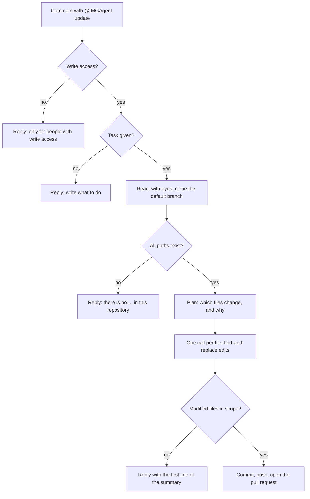

# update

`@IMGAgent update` carries out a small task by editing existing files in the folders you name and at the top level of the repository, and opens a pull request with the result. Folders named after `with` are only read, to check facts against.

## What it is for

`update` is for small changes that touch several files, where the files already exist. For example:

- `update src` and "require Python 3.13"
- `update docs with src` and "fix what is outdated"
- `update docs` and "fix the links between the pages"

It cannot create, delete or rename a file. If a task needs a new file, `update` changes what it can and says in the pull request what is left. To rebuild the documentation from scratch, use [make docs](make-docs.md). To ask a question without changing anything, use [ask](ask.md).

## Writing the command

```
@IMGAgent update docs with src
the docs still describe the old commands; bring them in line with the code
```

- The first list (`docs`) holds the **targets**: folders or files Claude may edit.
- The list after `with` (`src`) holds the **context**: folders or files Claude reads but never changes. A path that is in both lists counts as a target.
- The task may start on the same line or below, and span several lines. Start it on the next line if it begins with the word "with".

Both lists are comma-separated repository paths. Every path must exist in the repository, and it must not be absolute, contain `..`, `.git` or glob characters, or lead outside the repository through a symlink. The general rules are on the [Commands](index.md) page.

| Command | Reads | May change |
|---|---|---|
| `update src` | `src` and the top-level files | existing files in `src` and at the top level |
| `update docs with src` | `docs`, the top-level files and `src` | existing files in `docs` and at the top level |
| `update docs,examples` | `docs`, `examples` and the top-level files | existing files in those and at the top level |

The top-level files (such as `pyproject.toml` or `README.md`) are always read and may always be changed. Files under `.github/workflows/` are never changed, because the GitHub App has no Workflows permission and could not push them.

## What happens



1. IMGAgent checks that the person who wrote the command has write, maintain or admin permission. Others get a reply that the command is only for people with write access.
2. Without a task, IMGAgent asks for one, for example `@IMGAgent update docs require Python 3.13`.
3. It reacts with :eyes: to the comment, clones the default branch into a temporary folder, and checks that every target and context path exists there.
4. It runs `scripts/repo/update.py` in the clone (see below), with a time limit of 45 minutes.
5. It commits the allowed changes on a new branch and opens a pull request, then replies with a link to it.

`update` and `make` jobs in the same repository run one after the other, never at the same time.

### Which files Claude sees

The script reads every file tracked by git under the targets and the context, plus the tracked files at the top level. It skips:

- symlinks, files over 200,000 bytes, binary files and files that are not UTF-8;
- files matching `*.whl`, `*.png`, `*.jpg`, `*.jpeg`, `*.gif`, `*.svg`, `*.ico`, `*.pdf`, `*.zip`, `*.gz`, `*.lock`, `package-lock.json`, `LICENSE` and `NOTICE`.

If the selected files add up to more than 600,000 characters (about 150k tokens), nothing is changed and IMGAgent replies that the folders are too large to read at once. Name smaller folders.

The files are split into two groups in the prompt:

`<editable>`
:   Files under the targets and at the top level, except anything under `.github/workflows/`.

`<context>`
:   Everything else that was read: the `with` folders and any workflow files. Claude is told to use them only to check facts.

### Plan, then edit

Claude works in two steps:

1. **Plan.** One call reads the task and lists the editable files that need a change, each with a precise note on what to change. It may also add a note for the maintainer, for example about parts of the task that would need a new file. Files in the plan that may not be changed are skipped and listed as such in the summary. Several entries for the same file are merged.
2. **Edit.** One call per planned file (up to four at a time) returns find-and-replace edits. Each edit's `find` text must occur exactly once in the current file; an edit that doesn't match exactly once is skipped and reported. Text that is still right stays byte for byte as it was.

Claude is instructed to change only what the task needs, keep the existing wording and style, and never invent versions, options, URLs or behaviour that are not in the files or the task. The models have no tools: they only return the plan and the edits as JSON, which the script applies.

### What gets committed

After the script finishes, IMGAgent looks at `git diff` in the clone and commits only files that:

- were already tracked and were **modified** (not added or deleted), and
- are under one of the targets or at the top level, and not under `.github/workflows/`.

Any other change in the clone is left out of the pull request and noted as a warning in the server log. The context folders are never committed.

If no file qualifies, IMGAgent replies in the issue with the first line of the summary, or "nothing needed to change."

## The pull request

| | |
|---|---|
| Branch | `<slug>/update-<targets>-<random hex>`, where `<targets>` is the target names joined by `-`, lowercased, other characters replaced by `-`, at most 40 characters (`repo` if nothing is left) |
| Title | `<targets>: <task>`, with the targets separated by `, ` and the task shortened to 60 characters |
| Body | `Task:` and the task, the summary of the script, and a note that Claude could only edit existing files in the targets and at the top level |

The summary lists each changed file with its reason. It marks files as **unchanged** when no edit applied, **skipped** when the plan named a file that may not be changed, and says how many edits could not be applied where that happened, so you can check those files by hand. It ends with the model, effort and token usage.

The commit author, the filled-in AI declaration and the assignment to the requester are described on [Pull requests](pull-requests.md).

## Models

`update` uses `WRITER_MODEL` (default `claude-opus-5-5`) with `WRITER_EFFORT` (default `medium`), the same settings as `make docs`. The old names `DOCS_WRITER_MODEL` and `DOCS_WRITER_EFFORT` still work. See [Environment variables](../reference/index.md).

For model ids starting with `claude-opus-5`, `claude-sonnet-5-5` or `claude-fable-5`, a request that a safety classifier refuses is rerun on a fallback model by the API.

## Running the script locally

`scripts/repo/update.py` also runs on its own, from the root of the repository you want to change. It edits the working tree; review the result with `git diff`.

```bash
pip install anthropic
export ANTHROPIC_API_KEY=sk-ant-...
TARGETS=docs CONTEXT=src python path/to/imgagent/scripts/repo/update.py "fix what is outdated"
```

The task is taken from the arguments, or from `TASK` if there are none. Without `SUMMARY_FILE`, the summary is printed.

| Variable | Meaning | Default |
|---|---|---|
| `REPO_ROOT` | the repository | the current directory |
| `TARGETS` | comma-separated folders or files to work on, relative to `REPO_ROOT` | required |
| `CONTEXT` | comma-separated folders or files to read but not change | none |
| `TASK` | what to do, if not given as arguments | |
| `DOCS_PROJECT` | the project's name | the folder name of `REPO_ROOT` |
| `DOCS_ABOUT` | one sentence on what the project is | none |
| `WRITER_MODEL` | model id | `claude-opus-5-5` |
| `WRITER_EFFORT` | `low`, `medium`, `high`, `xhigh` or `max` | `medium` |
| `SUMMARY_FILE` | where to write the Markdown summary | printed instead |

!!! note
    When run by hand, the script itself only restricts what Claude may edit; it does not commit anything. The check that only modified tracked files in scope are committed is done by IMGAgent, not by the script.

When IMGAgent runs it, `DOCS_PROJECT` and `DOCS_ABOUT` come from the optional [repository settings file](../reference/repo-config.md) or the repository's name and description.

## When something goes wrong

- **No reply at all:** see [Troubleshooting](../operations/troubleshooting.md).
- **"there is no `...` in this repository":** a target or `with` path doesn't exist on the default branch, or points outside the repository.
- **"IMGAgent couldn't finish this (`update`)":** the script failed or a GitHub call failed; the details are in the server log.
